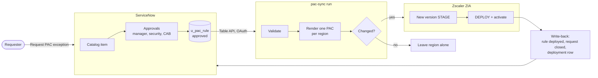
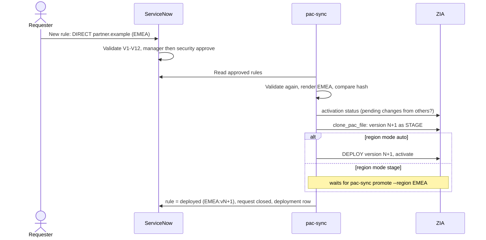
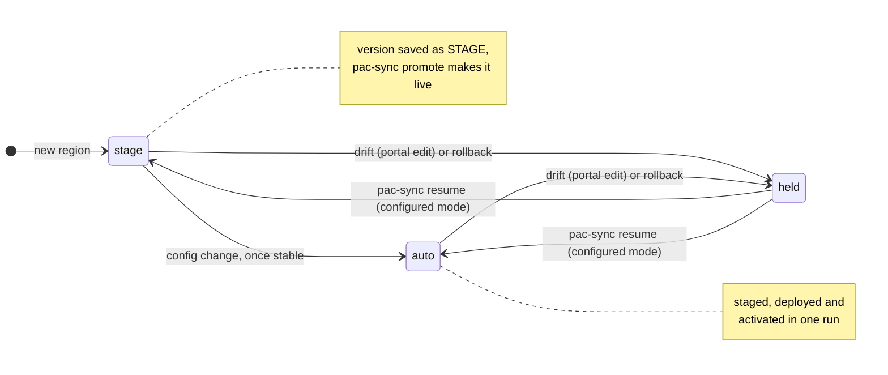

# PAC Sync

**PAC exceptions as an approved, versioned, reversible workflow.** Users request a PAC exception in ServiceNow.
Once it is approved, PAC Sync rebuilds that region's PAC file and deploys it to Zscaler ZIA as a new PAC version,
then reports the result back to the request. No more hand edits in the ZIA portal.

| | |
| --- | --- |
| **Input** | Approved `u_pac_rule` records in ServiceNow (or the local mock [`snow-mock`](https://github.com/cheikhnorris/snow-mock)) |
| **Output** | One PAC file per region in ZIA (EMEA, APAC, NA, ...), each change a ZIA PAC version |
| **History** | `history.mode`: `git` (default, a git repository per region), `zia` (ZIA's own PAC versions only, used by the demo profile) or `both`; `versions`, `diff` and `rollback` read ZIA |
| **Safety** | Validation on both sides, 20% removal guardrail, drift detection, never activates other admins' changes, separation of duties |
| **Runs** | On a schedule (every 15 minutes), on demand, or in Docker |

Read next: [docs/OVERVIEW.md](docs/OVERVIEW.md) (high-level) and [docs/SETUP-NEW-LAPTOP.md](docs/SETUP-NEW-LAPTOP.md)
(step-by-step setup: local demo, then a real tenant).

### How it fits together



### One change, end to end



### Region modes and versions

Each region has a configured mode (`regions.<CODE>.mode` in the config). Drift or a rollback pauses the region
on top of that mode until someone runs `pac-sync resume`.



ZIA keeps 10 versions per PAC file. PAC Sync picks the version to delete itself and never deletes the live, staged
or LKG (last known good) one. `pac-sync rollback --region X --to lkg` redeploys a known-good version in seconds.

## Quick start (5 minutes)

Needs git, Python 3.10 - 3.12 and PHP 8.4 (the launcher offers `winget install PHP.PHP.8.4`). Double-click
`start-poc.cmd`, or from a terminal:

```powershell
.\start-poc.cmd                                           # uses config\config.yaml; creates it from the demo profile if missing
.\start-poc.cmd -Config config\config.demo.local.yaml     # another config file
.\start-poc.cmd -Reset                                    # fresh demo: mock database and the demo state file deleted
.\start-poc.cmd -Offline                                  # Python cannot reach the internet: install from wheels\
```

`-Offline` installs the SDK, every dependency and pytest from the committed `wheels\` folder with `pip --no-index`.
Those wheels are for Python 3.11, 64-bit Windows. Rebuild them on a machine with internet (same Python version) with
`python -m pip wheel -w wheels ..\zscaler-sdk-python "requests>=2.31" "jinja2>=3.1" "pyyaml>=6.0" "pytest>=8" setuptools wheel`.

It checks the prerequisites, creates `.venv`, installs the SDK (editable from `..\zscaler-sdk-python` when present,
else from PyPI) and pac-sync, writes `config\config.yaml` + `.env` with `pac-sync setup --profile demo` when there is
no config (it asks for the ZIA credentials: pac-sync only drives a real ZIA tenant, see "Demo on a real tenant"),
starts the ServiceNow mock on http://127.0.0.1:8090, runs `pac-sync doctor` and a first `pac-sync run`,
then opens the portal. No ExecutionPolicy change. Other switches: `-NoBrowser`,
`-SkipSync`, `-MockPath`, `-SdkPath`. `-Reset` never touches `pac-history\`.

The demo profile (`config/config.demo.yaml`) uses the ServiceNow mock and a real ZIA tenant with prefixed PAC files
(`demo-`), history mode `zia`. A run only creates the PAC file of auto-mode regions; for the others doctor prints the
`pac-sync bootstrap --region X --yes` command.

Demo script:

1. In the portal, act as **jdoe** (menu top right) and submit **Request PAC exception**: new rule, region EMEA.
2. Approve it as **mmanager**, then **nsec** (and **cab** for a global rule). The rule is now `approved`.
3. `.venv\Scripts\pac-sync run`
4. The request closes (`closed_complete`), the rule shows `deployed` with its ZIA version, and the request page lists
   the `u_pac_deployment` rows.
5. Check the version in the ZIA admin portal or with `pac-sync versions --region EMEA`.
   NA changes stay staged until `pac-sync promote --region NA`.

### Switch to a real tenant

1. `pac-sync setup --profile custom` (or `--force` to replace an existing config): asks for ServiceNow, the ZIA
   target (OneAPI client secret, OneAPI private key, legacy API key) and the history remote. Secrets are
   read hidden and written only to `.env`.
2. `pac-sync doctor`: every line must be OK (it reads ServiceNow and ZIA, changes nothing, never prints a secret).
3. A region whose PAC file does not exist yet fails doctor with its name: `pac-sync bootstrap --region EMEA`
   creates it (asks for confirmation on a live tenant, or `--yes`).
4. With `zscaler.target: live`, `deploy.live_max_mode: stage` keeps every region at most on `stage` until you remove it.

| ZIA auth | Config | Environment variables (in `.env` or the environment) |
| --- | --- | --- |
| OneAPI client secret | `target: live`, `auth: oneapi` | `ZSCALER_CLIENT_ID`, `ZSCALER_CLIENT_SECRET`, `ZSCALER_VANITY_DOMAIN` |
| OneAPI private key | `target: live`, `auth: oneapi`, `private_key_env: ZSCALER_PRIVATE_KEY` | `ZSCALER_CLIENT_ID`, `ZSCALER_PRIVATE_KEY` (PEM text or key file path), `ZSCALER_VANITY_DOMAIN` |
| Legacy (not on ZIdentity) | `target: live`, `auth: legacy` | `ZIA_USERNAME`, `ZIA_PASSWORD`, `ZIA_API_KEY`, `ZIA_CLOUD` (e.g. `zscalertwo`) |

`.env` is plaintext and git-ignored: protect the file (NTFS permissions) on a shared host. Ending a ZIA API
session activates pending changes, and both SDK clients end it on close (legacy always, OneAPI after any write). So
PAC Sync closes the client only when `activate.status()` is ACTIVE; otherwise it logs a warning and leaves the session
to expire, so other admins' pending changes are not activated by PAC Sync.

The ServiceNow side (tables, workflow, validation, integration account) is specified in the
**PAC Sync – ServiceNow Implementation Requirements** document. The field names there are the contract with this code.

For local development without a ServiceNow instance, run the PHP mock in [`../snow-mock`](../snow-mock/README.md)
and use `config/config.demo.yaml` (Table API over OAuth, real ZIA tenant; see Quick start).

## Layout

| Path | Role |
| --- | --- |
| `pac_sync/snow_client.py` | Table API client (OAuth or basic, paging, retries) and the offline `file` source |
| `pac_sync/normalizer.py` | Validation (host, domain, CIDR, URL pattern, injection characters), scope, validity dates, duplicate/conflict detection |
| `pac_sync/renderer.py` | Deterministic Jinja2 rendering + SHA-256 |
| `pac_sync/history.py` | Git repository: content, rule snapshot, ZIA state, tags |
| `pac_sync/deployer.py` | ZIA client factory (OneAPI / legacy), `pac_files` stage / deploy / rollback / bootstrap, `activate` |
| `pac_sync/zia_history.py`, `zia_messages.py`, `zia_cli.py` | History mode `zia`, ZIA version commit messages, `versions` / `diff` / `lkg` / `demo-cleanup` |
| `config/config.demo.yaml` | Mock ServiceNow + real ZIA with prefixed PAC files (see Demo on a real tenant) |
| `pac_sync/envfile.py` | `.env` loading and writing, required environment variables |
| `pac_sync/doctor.py` | `pac-sync doctor` read-only checks |
| `pac_sync/setup_wizard.py` | `pac-sync setup` profiles (demo, custom) |
| `pac_sync/writeback.py` | Status updates for ServiceNow |
| `pac_sync/main.py` | Orchestration, guardrails, lock, CLI |
| `start-poc.cmd`, `start-poc.ps1` | One-step local proof of concept (see Quick start) |
| `config/config.example.yaml` | Every setting, commented |
| `config/servicenow_sample_data.json` | Sample ServiceNow records covering every case (valid, expired, future, retire, invalid, conflict) |
| `templates/proxy.pac.j2` | PAC template |

## Setup

```bash
python -m venv .venv && . .venv/Scripts/activate      # Linux: . .venv/bin/activate
pip install -e ".[dev]"                                # Python >= 3.10 (required by zscaler-sdk-python)
cp config/config.example.yaml config/config.yaml
pytest
```

Or `pac-sync setup` (interactive) to write `config/config.yaml` and `.env`.

Environment variables (names configurable in `config.yaml`). They can live in a `.env` file in the project root, i.e.
the parent of the config file's folder (`config/config.yaml` -> `./.env`; the current directory's `.env` is the fallback
when there is none there). It is git-ignored, has `KEY=value` lines, is loaded before the config, and `--env-file`
chooses another file. A variable already set in the process environment always wins over `.env`. Quote values with
spaces or `#`; inside double quotes only `\\ \" \n \r \t` are escapes, so put a Windows path such as
`C:\keys\new.pem` in single quotes.

| Variable | Purpose |
| --- | --- |
| `SNOW_CLIENT_ID`, `SNOW_CLIENT_SECRET` | ServiceNow OAuth client credentials (or `SNOW_USERNAME` / `SNOW_PASSWORD` with `auth: basic`) |
| `ZSCALER_CLIENT_ID`, `ZSCALER_CLIENT_SECRET`, `ZSCALER_VANITY_DOMAIN` | Zscaler OneAPI credentials with ZIA PAC file + activation permissions (see the auth table above for private key and legacy) |
| `PAC_SYNC_WEBHOOK_URL` | Optional Teams / Slack incoming webhook |
| `PAC_SYNC_CONFIG` | Optional path to the config file |

**Bootstrap, once per region:** the PAC file named in `u_pac_region.u_zia_pac_name` must exist in ZIA with a
deployed version. Create it with `pac-sync bootstrap --region EMEA` (the current render becomes version 1,
DEPLOYED; `zscaler.pac_domain` must be set), in the ZIA admin portal, or let a run do it with
`zscaler.bootstrap: missing` (refused on a live target capped by `deploy.live_max_mode`). That keeps the hosted PAC
URL stable; PAC Sync only adds versions to it, so ZCC forwarding profiles and app profiles never need to change.

## Commands

```bash
pac-sync run --dry-run              # render + git diff --stat, then discard: no commit, no ZIA, no write-back
pac-sync run                        # the scheduled job
pac-sync render --region EMEA       # print a region's PAC to stdout
pac-sync promote --region NA        # deploy the STAGE version you reviewed (refused if the render changed since)
pac-sync rollback --region EMEA --version 41   # redeploy an older ZIA version and pause the region
pac-sync rollback --region EMEA --to lkg       # redeploy the last known good version (--version and --to are exclusive)
pac-sync resume --region EMEA       # clear a pause (rollback, "manual change in ZIA") and accept the current ZIA version
pac-sync status                     # each region's recorded ZIA state (offline in git modes)
pac-sync versions --region EMEA     # every ZIA version: status, times, modified by, PAC Sync or manual, +/- PACR, message
pac-sync diff --region EMEA --from deployed --to render    # N | deployed | staged | lkg  ->  N | deployed | staged | lkg | render
pac-sync lkg --region EMEA --version 41                     # mark a version last known good
pac-sync lkg --region EMEA --remove [--new-lkg 40]          # unmark it (optionally name the next one)
pac-sync bootstrap --region EMEA    # create the region's PAC file in ZIA (asks on a live tenant, never without a console; --yes to skip)
pac-sync demo-cleanup --yes         # delete the PAC files that start with zscaler.pac_name_prefix (needs only_prefixed: true)
pac-sync doctor                     # read-only checks, exit 1 if any FAIL
pac-sync doctor --write-probe --region EMEA   # also stage + unstage one PREFIXED PAC file, then activate (only if ZIA is ACTIVE first)
pac-sync setup [--profile demo|custom] [--non-interactive] [--force]
```

`run --force` also overrides a "manual change in ZIA" pause (see Versioning).

Exit codes: `0` ok, `1` at least one region failed or was blocked, or the git push failed (ZIA state and
ServiceNow write-back are still done; the commits go out with the next successful push), `2` aborted by a
guardrail, `3` unexpected error. A run that saved versions in ZIA but did not activate them (activation guard) also exits `1`.

## Deploy modes: staged first, automatic once stable

Set per region in `config.yaml`:

| Mode | What a run does |
| --- | --- |
| `stage` | Creates a ZIA STAGE version (replacing any older staged one). Production is untouched. Test, then `pac-sync promote --region X`. |
| `auto` | Stages, activates, deploys, activates in the same run. |
| `paused` | Renders and commits to git only. |

Suggested rollout:

1. All regions on `stage`. ServiceNow team loads the 20 sample rules in TEST; check each staged PAC in ZIA, then promote.
2. After two weeks of clean promotions in a region (no manual fix, no rollback), switch it to `auto`.
3. Keep the guardrail and webhook on in `auto`; a blocked run never deploys.

## History

The git repository at `history.repo_path` is the history of record, because ZIA keeps only the last 10 versions of a
PAC file (the SDK evicts the oldest on each clone).

```
regions/EMEA/proxy.pac     exact content sent to ZIA
regions/EMEA/rules.json    rules behind it (PACR number, action, value, profile, regions, priority)
regions/EMEA/state.json    pac_id, staged {version, hash, commit}, deployed {version, hash, commit}, last_error, paused_reason
```

- Each run that changes a PAC makes one commit, with the rules added and removed per region by PACR number.
- Each ZIA deployment adds a tag `<CODE>-v<version>`; rollbacks add `<CODE>-v<version>-rollback`.
- Useful queries: `git log -p regions/EMEA/proxy.pac`, `git log -S "portal.partner-example.com"` (when was a host added or removed), `git diff EMEA-v41 EMEA-v42`.
- Set `history.push: true` and add a remote (GitLab, GitHub, Azure DevOps) so the history survives the host.
- PAC Sync only commits, diffs and discards under `regions/`, so other files can share the repository (the snow-mock
  backups in `backups/` do); its lock file `.pac-sync.lock` is shared with `..\snow-mock\backup.ps1`.

## Safety

- **Validation:** every value is checked against its match type, and quotes, `;`, `\` and whitespace are refused, so a ServiceNow value can never inject JavaScript into the PAC. Rejected rules are reported back to ServiceNow.
- **Determinism:** rules are sorted by priority, action, match type, value, so unchanged input gives a byte-identical PAC and no redeploy.
- **Guardrails:** a run that would remove more than 20% of a region's rules (once it has 10 or more) blocks that region; 0 rules from ServiceNow while git has rules aborts the run.
- **Isolation:** one region failing never stops the others.
- **Lock:** a lock file in the history repo prevents overlapping runs.
- **ZIA validation:** `clone_pac_file` calls ZIA's `/pacFiles/validate` before creating any version.

## Scheduling

- **Linux cron:** `*/15 * * * * cd /opt/pac-sync && .venv/bin/pac-sync run >> /var/log/pac-sync.log 2>&1`
- **Windows Task Scheduler:** action `C:\pac-sync\.venv\Scripts\pac-sync.exe`, arguments `run`, start in `C:\pac-sync`, repeat every 15 minutes.
- **Kubernetes:** a `CronJob` with `concurrencyPolicy: Forbid`, the history repo cloned from its remote at start, `history.push: true`.
- **Docker:** the image does one `pac-sync run` per start. Mount a folder at `/data` holding `config/config.yaml`
  and `.env`; the state file and the lock (`history.mode: zia`) land beside them. For `git` / `both`, set
  `history.repo_path: /data/pac-history`.
  ```
  docker build -t pac-sync .
  docker run --rm -v /srv/pac-sync:/data pac-sync                 # one run; cron it: */15 * * * * docker run ...
  docker run --rm -v /srv/pac-sync:/data pac-sync doctor           # any other command
  ```
  From a container, the local mock is `http://host.docker.internal:8090`, and the mock only answers localhost:
  start it with `SNOW_MOCK_ALLOWED_CLIENTS` set to the Docker network (for example `172.16.0.0/12`).
- **Write-back failures** (ServiceNow down, a refused update) make the run exit 1 and are notified. Rule statuses
  are re-sent by the next run; a missed deployment row is not.

## Demo on a real tenant

`config/config.demo.yaml` drives a REAL ZIA tenant from the mock ServiceNow without touching production PAC files:
every PAC file is named `demo-<u_zia_pac_name>` (`zscaler.pac_name_prefix`), `zscaler.only_prefixed: true` refuses any
write to another file before a request is sent, `deploy.skip_activate_if_pending: true` never activates other admins'
pending changes, and `history.mode: zia` needs no git. EMEA and APAC are `auto`, NA is `stage` (to show `promote`).

**Checklist before the demo**

1. Auth mode: OneAPI (recommended). Legacy works too (doctor warns). With either one, ZIA activates pending changes
   when an API session ends, so PAC Sync leaves the session to expire when changes are pending.
2. A ZIA admin role with full access to Hosted PAC Files plus activation, and nothing else (the exact permission names are
   unverified; check them in your tenant). OneAPI: a ZIdentity API client with that role: client id, client secret (or a
   private key), the vanity domain, the cloud if not production. Legacy: API key, cloud, admin user and password.
3. The PAC domain ZIA wants when it creates a PAC file (`zscaler.pac_domain`).
4. A prefix that no existing PAC file or ZCC forwarding profile uses (default `demo-`).
5. ZIA admin portal: no pending changes (the banner shows them). Otherwise the demo still runs, but saves versions
   without activating them and exits 1.
6. Version headroom: a new PAC file starts at 1 version; ZIA keeps 10 per file.

**On the laptop**

```powershell
.\start-poc.cmd -Profile demo      # first time: asks for the credentials (hidden), writes config\config.yaml + .env
.venv\Scripts\pac-sync doctor --write-probe --region EMEA    # optional: proves the write permissions on a prefixed file
.venv\Scripts\pac-sync bootstrap --region NA --yes           # stage-mode regions are never created by a run
.venv\Scripts\pac-sync run
```

The write probe clones the deployed version as STAGE, unstages it and then ACTIVATES, so it runs only when ZIA is
ACTIVE beforehand (otherwise it is refused: activate or coordinate in the portal first, because the activation would
publish someone else's pending changes) and leaves ZIA ACTIVE afterwards; a probe that left ZIA PENDING would make
`skip_activate_if_pending` skip the next run. It leaves one UNSTAGED version (it counts toward the 10) and, at the cap,
deletes the same safe version a stage would. If the activation fails the probe says so and what to do.

`start-poc.cmd -Profile demo` runs setup (when `config\config.yaml` is missing), then doctor, and prints the `bootstrap
--region X --yes` commands for regions a run will not create; it never runs them on a live tenant. Use `-Config` for a
separate file (`config\config.demo.local.yaml` is git-ignored).

**Demo script**

1. Mock portal: submit a rule as `jdoe`, approve as `mmanager` and `nsec` (and `cab` for global rules).
2. `pac-sync run`: EMEA is staged, deployed and activated; the request closes; NA is staged and the rule says
   "Staged as NA v2; waiting for promotion".
3. ZIA admin portal, Hosted PAC Files (menu names may differ): open `demo-emea-proxy.pac` > versions: one new version whose
   message reads `PAC Sync <run> EMEA +PACR... sha256:...`.
4. `pac-sync versions --region EMEA`, `pac-sync diff --region EMEA --from 1 --to deployed`.
5. `pac-sync promote --region NA`.
6. `pac-sync rollback --region EMEA --to lkg`: the previous version is live again, the region is paused, the request
   page and `/pacsync` (mock) show a "Rolled back" row. `pac-sync resume --region EMEA` ends the pause.
7. Mock portal: the request page shows the ZIA version; `/pacsync` shows the latest deployed and staged version per region.

**After the demo**: `pac-sync demo-cleanup --yes` (deletes only `demo-` files), delete `pac-state.json`, rotate or delete the
ZIA API client secret, remove the `.env` values.

## Versioning

ZIA keeps at most 10 versions per PAC file, and each version carries a commit message. PAC Sync makes those messages
the audit trail:

```
PAC Sync 20261101T101530Z EMEA +PACR0001017,PACR0001018 -PACR0001003 sha256:d7592d068bcc git:1f4797af91
PAC Sync 20261101T101530Z NA bootstrap sha256:463234aa0cd1          (also: probe, rollback-to v41)
```

`<run id>` is the UTC start of the run, `+`/`-` are the rules added and removed (a long list becomes `+12 (PACR0001001...)`),
`sha256` is the first 12 characters of the content hash, `git` the history commit (absent in mode `zia`). The message is
at most 255 characters (assumed ZIA limit). `pac-sync versions` reads it back; a version without it was changed by a
person in the portal.

| `history.mode` | History of record | Needs |
| --- | --- | --- |
| `git` (default) | the git repository at `history.repo_path` | git |
| `both` | git, plus `regions/<CODE>/zia-archive/v<N>.pac` + `.json` for every version ZIA is about to delete | git |
| `zia` | the ZIA versions; state (`deployed`, `staged`, `pac_id`) is derived from them; pauses and errors in `history.state_file` (git-ignored, `pac-state.json` in the project, i.e. relative to the config folder's parent, with the run lock beside it) | nothing; `history.archive_dir` optionally keeps deleted versions |

In mode `zia` the removed-rules guardrail reads the PACR numbers back from the `// <number> <ACTION>` comments of the
deployed PAC, and `run --dry-run` prints a unified diff of deployed vs the new render. The run lock sits next to the state
file.

**The 10-version cap.** The SDK's `clone_pac_file` deletes the lowest version number at the cap, even a DEPLOYED one. PAC Sync
passes an explicit `delete_version`: the lowest version that is not DEPLOYED, LKG or STAGE, logs `evicting v<N> (<status>,
"<message>")` and archives it first (modes `both` and `zia` with `archive_dir`). When nothing can be deleted the region fails
with "10 versions and none can be deleted: remove the LKG mark or delete versions in the portal". Doctor warns when a PAC file has 9 or more
versions and none of them can be deleted (all DEPLOYED, LKG or STAGE).

**Manual changes.** If the DEPLOYED version's message is not a PAC Sync message (or, in git modes, it is not the version
`state.json` recorded), the region is paused with "manual change in ZIA" and the run exits 1. `pac-sync resume --region X`
accepts the current version; `pac-sync run --force` overwrites it. The first run on a PAC file created by hand needs one
of the two.

**Not activated.** With `deploy.skip_activate_if_pending`, `activate.status()` is read before the first write. Anything but
ACTIVE means someone else has pending changes: versions are saved, `activate()` is never called, the run exits 1 and
the log, the notification, `u_pac_deployment.u_summary` and each rule's `u_deploy_message` say "saved in ZIA, not
activated: other changes were pending or the activation failed (see the log); review and activate in the portal". The
rules of those regions stay `staged` with
"saved in ZIA as EMEA v3, not activated: activate in the portal; the next run confirms" and keep their `u_state`, so the
request stays open; they become `deployed` (and the request closes) on a later run that finds ZIA ACTIVE, which also logs a
`u_pac_deployment` row "activation confirmed". Other regions' rules get no such note. A PAC file created that way is not cloned
until ZIA is active again (the SDK documents a 400 otherwise). `deploy.mark_lkg_after_deploy: true` marks the previous version
LKG after a successful deploy and activation.

## Verify before production

`tests/test_deployer_sdk.py` runs `ZiaDeployer` through the real SDK (URL building, body serialization, response
models) with only the OAuth token and the HTTP send replaced. That proves what the code sends, not how ZIA answers.
The test fake (`tests/fake_zia.py`) copies the same assumptions. Check these in a test tenant:

1. `update_pac_file(..., pac_version_action="DEPLOY")` and `"UNSTAGE"` accept the body `deployer._action` sends.
2. Whether ZIA allows more than one STAGE version per PAC file (the code unstages the old one first).
3. Whether `clone_pac_file` returns the new `pac_version` (there is a fallback that re-reads the versions).
4. Whether an `activate()` is needed between staging and deploying (the code does both).
5. Whether `add_pac_file(..., pac_version_status="DEPLOYED")` (bootstrap) is accepted with the configured
   `zscaler.pac_domain`.
6. Phase 1b assumptions (none verified against a tenant): `DEPLOY` demotes the previous version to LKG on its own; the
   `deleteVersion` rules (only non-DEPLOYED, non-LKG, non-STAGE versions are accepted); the 255-character message limit;
   that `pacContent` comes back unchanged apart from line endings and trailing whitespace (the mode `zia` hash depends on it);
   the `lastModificationTime` format (epoch seconds or milliseconds are both handled); the `activate.status()` values (only
   `ACTIVE` counts as clean) and whether it reflects other admins' changes; whether a PAC deploy needs an activation; rate
   limits; the admin role permission names.
